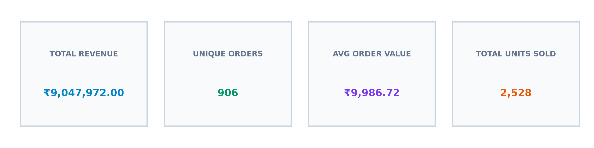
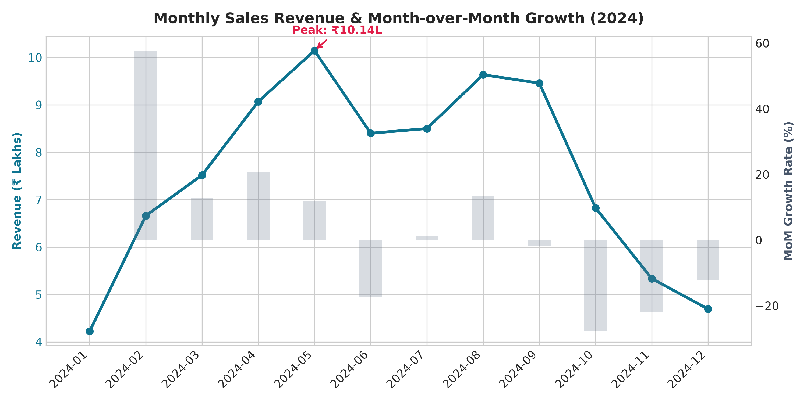
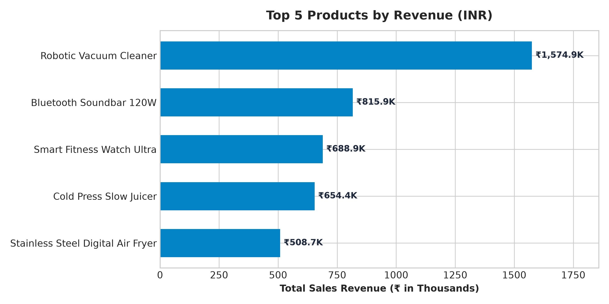
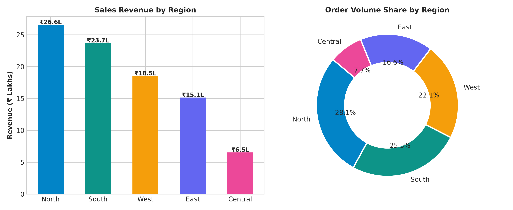
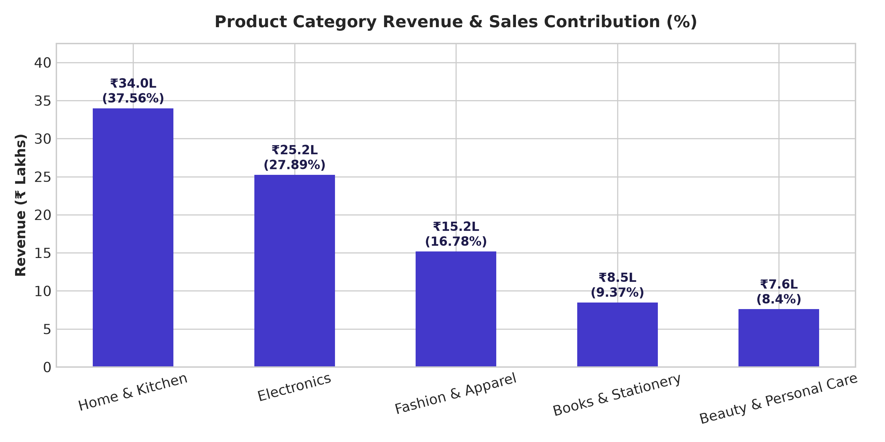

# Retail Sales Analysis Dashboard

[](https://www.python.org/)
[](https://pandas.pydata.org/)
[](https://www.sqlite.org/)
[](https://powerbi.microsoft.com/)
[](https://www.microsoft.com/excel)
[](https://docs.pytest.org/)
[](https://opensource.org/licenses/MIT)

> An end-to-end, production-grade business intelligence and data analytics portfolio project demonstrating practical expertise in **Python (Pandas, NumPy, Matplotlib)**, **SQL (SQLite)**, **Microsoft Excel**, and **Microsoft Power BI Desktop**.

---

## 📌 Executive Dashboard Preview



```
=============================================================================
                          EXECUTIVE KPI OVERVIEW
=============================================================================
  Total Sales Revenue:      ₹9,047,972.00 INR
  Unique Customer Orders:   906 Orders
  Average Order Value (AOV):₹9,986.72 INR
  Total Physical Units Sold:2,528 Units
  Active Catalog SKUs:      25 Products (5 Categories, 5 Regions)
  Best Performing Month:    May 2024 (₹1,014,454.00 INR | 105 Orders)
  Lowest Performing Month:  January 2024 (₹422,399.00 INR | 39 Orders)
=============================================================================
```

---

## 🏢 Business Problem & Objectives

A fictional Indian multi-category retail enterprise (**"Apex Retail India"**) needed visibility into its commercial performance across multiple dimensions to answer fundamental business questions:

1. **Revenue & Basket Dynamics:** What is our total revenue, order volume, and Average Order Value (AOV)?
2. **Catalog Velocity:** Which products drive top-line revenue versus inventory velocity?
3. **Seasonality:** How do sales fluctuate month-over-month, and when are demand surges strongest?
4. **Regional Penetration:** Which sales territories drive market share, and where are expansion opportunities?
5. **Data Integrity:** How do we establish automated data validation and deduplication without discarding valid multi-product shopping carts?

---

## 🛠️ Technology Stack

| Layer | Technology | Primary Role in Project |
| :--- | :--- | :--- |
| **Data Cleaning & Pipeline** | Python (Pandas, NumPy) | Ingestion, type casting, text cleaning, duplicate detection, revenue reconciliation, audit report |
| **Statistical Visualizations** | Matplotlib, Plotly | Publication-ready visual charts, trend tracking, distribution analysis |
| **Relational Database** | SQL (SQLite) & SQLAlchemy | Relational schema creation, indexed querying, window functions (`LAG`), CTEs |
| **Business Intelligence** | Microsoft Power BI Desktop | Star schema data model, 1-to-many relationships, DAX measures, interactive slicers |
| **Spreadsheet Analysis** | Microsoft Excel | Raw data auditing, PivotTables, formula verification, cross-tool reconciliation |
| **Local Interactive Web UI** | Streamlit *(Supplementary)* | Lightweight local browser dashboard and interactive SQL runner |
| **Testing & Quality Assurance**| Pytest | Automated regression unit tests for cleaning rules and analytics formulas |
| **Version Control** | Git & GitHub | Modular directory structure, commit lineage, documentation |

---

## 📂 Repository Structure

```
retail-sales-analysis-dashboard/
│
├── data/
│   ├── raw/
│   │   ├── retail_sales_raw.csv         <- Raw ingested transaction dataset
│   │   └── retail_sales_raw.xlsx        <- Raw Excel workbook for inspection
│   ├── processed/
│   │   ├── retail_sales_cleaned.csv     <- Cleaned, validated fact dataset (1,500 rows)
│   │   ├── retail_sales_cleaned.xlsx    <- Cleaned Excel dataset for PivotTable modeling
│   │   ├── dim_date.csv                 <- Calendar date dimension table for Power BI
│   │   └── retail_sales.db              <- SQLite relational database
│   └── DATASET_METADATA.md              <- Schema definitions, provenance, and public alternatives
│
├── src/
│   ├── generate_data.py                 <- Generates realistic synthetic transactions (seed: 42)
│   ├── clean_data.py                    <- Auditable data cleaning and quarantine pipeline
│   ├── analyze_sales.py                 <- Computes 15 business metrics & renders charts
│   ├── load_database.py                 <- Ingests cleaned data into SQLite & executes SQL queries
│   ├── create_notebook.py               <- Generates the structured Jupyter Notebook
│   └── app.py                           <- Supplementary interactive Streamlit web dashboard
│
├── sql/
│   └── sales_analysis.sql               <- Comprehensive SQL BI queries with CTEs and Window Functions
│
├── powerbi/
│   ├── powerbi_dashboard_guide.md       <- Step-by-step Power BI Desktop assembly manual
│   └── dax_measures.md                  <- Catalog of production DAX measures and formulas
│
├── excel/
│   └── excel_analysis_guide.md          <- Excel auditing, formulas, PivotTables, and reconciliation
│
├── reports/
│   ├── sales_analysis_report.md         <- Comprehensive business intelligence report
│   ├── data_quality_report.md           <- Lineage audit trail of all cleaning steps
│   ├── metrics_summary.json             <- Machine-readable ground truth metrics JSON
│   └── figures/                         <- Analytical charts generated from Python
│
├── notebooks/
│   └── retail_sales_analysis.ipynb      <- End-to-end interactive Jupyter notebook
│
├── screenshots/
│   ├── executive_kpi_summary.png        <- High-level executive KPI banner
│   ├── monthly_sales_trend.png          <- Line chart with MoM growth rates
│   ├── top_5_products_revenue.png       <- Ranked horizontal bar chart
│   ├── regional_sales_breakdown.png     <- Regional revenue and order share
│   └── category_sales_contribution.png  <- Category contribution percentages
│
├── tests/
│   ├── test_data_cleaning.py            <- Unit tests for cleaning, deduplication & quarantine
│   └── test_sales_metrics.py            <- Unit tests for mathematical correctness of all 15 metrics
│
├── .gitignore                           <- Git exclusion configuration
├── requirements.txt                     <- Project dependencies
└── README.md                            <- Comprehensive project documentation
```

---

## 📊 Analytical Findings & Visualizations

### 1. Monthly Revenue Trend & Month-over-Month Growth
Peak sales occurred in **May 2024 (₹1,014,454.00)**, followed by steady summer performance, while January served as the annual baseline (**₹422,399.00**).



---

### 2. Top 5 Products by Revenue
High-ticket smart home appliances generate outsized revenue:
1. **Robotic Vacuum Cleaner** — ₹1,574,895.00 (17.41% of total revenue)
2. **Bluetooth Soundbar 120W** — ₹815,898.00 (9.02%)
3. **Smart Fitness Watch Ultra** — ₹688,894.00 (7.61%)
4. **Cold Press Slow Juicer** — ₹654,423.00 (7.23%)
5. **Stainless Steel Digital Air Fryer** — ₹508,704.00 (5.62%)



---

### 3. Regional Sales Breakdown & Order Share
- **North Region:** ₹2,655,642.00 (29.35% revenue share, 255 unique orders)
- **South Region:** ₹2,369,532.00 (26.19% revenue share, 231 unique orders)
- **West Region:** ₹1,852,917.00 (20.48% revenue share, 200 unique orders)
- **East Region:** ₹1,514,919.00 (16.74% revenue share, 150 unique orders)
- **Central Region:** ₹654,962.00 (7.24% revenue share, 70 unique orders)



---

### 4. Category Revenue & Sales Contribution
- **Home & Kitchen:** ₹3,398,383.00 (37.56% of total revenue)
- **Electronics:** ₹2,523,793.00 (27.89%)
- **Fashion & Apparel:** ₹1,517,818.00 (16.78%)
- **Books & Stationery:** ₹848,136.00 (9.37% — highest volume driver with 564 units)
- **Beauty & Personal Care:** ₹759,842.00 (8.40%)



---

## 🧹 Data Cleaning Pipeline Highlights

Real-world datasets rarely arrive clean. The cleaning module [`src/clean_data.py`](file:///./src/clean_data.py) executes a transparent, non-destructive cleaning pipeline:

1. **Multi-Item Order Awareness:** Deduplication checks `['Order ID', 'Product ID']` rather than just `Order ID`, ensuring multi-product shopping baskets are never discarded.
2. **Quarantine Without Silent Drops:** Invalid records (e.g. `ORD-ERR-001` with `-2` quantity and `ORD-ERR-002` with `₹0.00` price) are isolated into a quarantined audit dataframe and documented in [`reports/data_quality_report.md`](file:///./reports/data_quality_report.md).
3. **Discrepancy Reconciliation:** Detects missing or clerical sales amount errors and reconciles them via `Sales Amount = Quantity * Unit Price`.
4. **Label Harmonization:** Normalizes 121 whitespace and casing anomalies (`"  electronics "` -> `"Electronics"`).

---

## 🗄️ SQL Analytics Capabilities

The SQL script [`sql/sales_analysis.sql`](file:///./sql/sales_analysis.sql) is fully commented and optimized with SQLite/ANSI SQL syntax:

- **Executive KPI Aggregations** (Total Sales, Distinct Orders, AOV, Units).
- **CTEs and Window Functions:** Uses `LAG()` to compute Month-over-Month percentage changes.
- **Dynamic Contribution Percentages:** Window functions `SUM(sales_amount) OVER ()` to compute category and regional market shares.
- **Top-N Rankings:** Grouped aggregations by SKU and volume.

Run the queries against SQLite via:
```bash
python src/load_database.py
```

---

## 📈 Power BI Desktop Implementation

The project includes ready-to-import processed datasets:
- **Fact Table:** `data/processed/retail_sales_cleaned.csv`
- **Date Dimension:** `data/processed/dim_date.csv`

Follow the step-by-step instructions in [`powerbi/powerbi_dashboard_guide.md`](file:///./powerbi/powerbi_dashboard_guide.md) and [`powerbi/dax_measures.md`](file:///./powerbi/dax_measures.md) to build:
1. Four modern KPI cards with INR formatting.
2. Chronologically sorted monthly line chart with MoM growth tooltips.
3. Top 5 Products bar chart with dynamic Top-N visual filters.
4. Regional donut chart and category column chart.
5. Interactive slicers (Date Range slider, Region tile filter, Category dropdown).

---

## 🚀 Quickstart Guide: Running Locally

### 1. Clone the Repository
```bash
git clone https://github.com/<your-username>/retail-sales-analysis-dashboard.git
cd retail-sales-analysis-dashboard
```

### 2. Set Up Virtual Environment (Recommended)
```bash
# Windows
python -m venv venv
venv\Scripts\activate

# macOS / Linux
python3 -m venv venv
source venv/bin/activate
```

### 3. Install Dependencies
```bash
pip install -r requirements.txt
```

### 4. Execute the End-to-End Pipeline
```bash
# Step 1: Generate synthetic raw dataset
python src/generate_data.py

# Step 2: Clean and validate dataset, produce data quality report
python src/clean_data.py

# Step 3: Run sales analysis, compute 15 metrics, export charts and JSON
python src/analyze_sales.py

# Step 4: Populate SQLite database and execute SQL analytics queries
python src/load_database.py

# Step 5: Run automated test suite
python -m pytest tests/ -v
```

### 5. Launch the Optional Interactive Streamlit Dashboard
```bash
streamlit run src/app.py
```

---

## 🧪 Automated Unit Testing

All cleaning rules and metric formulas are protected by automated tests in `tests/`:

```bash
python -m pytest tests/ -v
```

Expected output:
```
tests/test_data_cleaning.py::test_text_normalization PASSED              [ 11%]
tests/test_data_cleaning.py::test_standardize_dates PASSED               [ 22%]
tests/test_data_cleaning.py::test_deduplication_preserves_multi_item_orders PASSED [ 33%]
tests/test_data_cleaning.py::test_flag_and_quarantine_invalid_records PASSED [ 44%]
tests/test_data_cleaning.py::test_sales_amount_calculation_and_reconciliation PASSED [ 55%]
tests/test_sales_metrics.py::test_core_kpis PASSED                       [ 66%]
tests/test_sales_metrics.py::test_product_rankings PASSED                [ 77%]
tests/test_sales_metrics.py::test_monthly_aggregations_and_mom PASSED    [ 88%]
tests/test_sales_metrics.py::test_regional_and_category_breakdowns PASSED [100%]

============================== 9 passed in 1.27s ==============================
```

---

## 💡 Dataset Transparency & Limitations

- **Synthetic Notice:** Transactions were generated programmatically with fixed random seed (`42`). It simulates authentic retail patterns for portfolio evaluation and does not disclose real corporate trade secrets.
- **No COGS (Cost of Goods Sold):** Gross margins cannot be calculated as cost prices are not part of the standard transaction log.
- **Returns / Refunds:** The dataset assumes net fulfilled orders without explicit return merchandise authorizations (RMA).

---

## 📄 License

This project is licensed under the [MIT License](LICENSE).
